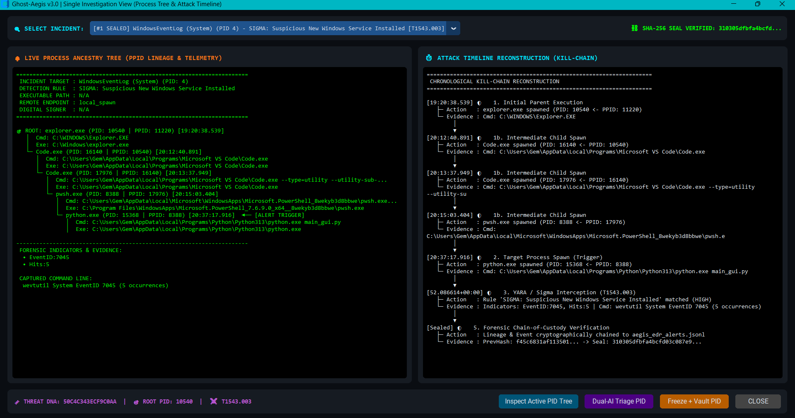

# 🛡️ Ghost-Aegis SE v3.0 — AI-Assisted Enterprise EDR/XDR & Forensic IR Platform


**Ghost-Aegis SE (Sentinel Edition)** is a host-based Endpoint Detection & Response (EDR), Extended Detection & Response (XDR), and Digital Forensics & Incident Response (DFIR) workbench built in Python and CustomTkinter. 

Designed with a **zero-DLL-dependency architecture** to operate cleanly on hardened Windows environments (WDAC/AppLocker), Ghost-Aegis combines real-time process interception, **native YARA and Sigma detection engines**, **PID-reuse-validated Process Ancestry Trees**, **Chronological Kill-Chain Reconstruction**, **RAM-suspended Quarantine Vaulting**, and **SHA-256 Cryptographic Chain-of-Custody sealing**.

---

## 📸 Live Platform Screenshots (v3.0)

### 1. Single Investigation View Workbench (Process Ancestry Tree & Kill-Chain Timeline)
*Correlates live `psutil` PPID process lineage (`explorer.exe` $\rightarrow$ `Code.exe` $\rightarrow$ `pwsh.exe` $\rightarrow$ `python.exe`), Windows Event ID `7045` Sigma detection (`T1543.003`), Threat DNA hashing (`50C4C343ECF9C0AA`), and verified SHA-256 chain-of-custody seals in a single pane:*



### 2. Main EDR/XDR Command Console & Cryptographic Alert Sealing
*Real-time YARA + Sigma PID interception, Windows Event ID hunting, Active Containment (Air-Gap, Quarantine Vault, ICMP Stealth), and tamper-evident SHA-256 ledger logging:*


---

## 🚀 What's New in v3.0

* **🖥️ Single Investigation View Workbench:** Unified side-by-side SOC investigation console correlating Process Ancestry Trees, 5-stage Attack Kill-Chain Timelines, Threat DNA hashes, MITRE ATT&CK mappings, and cryptographic block seals in one pane.
* **🌳 Live Process Ancestry Tree (`AegisForensicCorrelator`):** Walks the `psutil` Parent PID (`PPID`) chain up to 6 levels deep upon detection. Implements creation-time validation (`parent.create_time() <= child.create_time()`) to prevent Windows PID-recycling false positives.
* **⏱️ Chronological Kill-Chain Reconstruction:** Automatically stitches together initial parent execution, intermediate child spawns, YARA/Sigma command-line interception, network telemetry, SOAR containment, and forensic ledger sealing.
* **📜 Native Pure-Python Sigma Engine (`AegisSigmaEngine`):** Zero-dependency YAML parser evaluating both real-time process creation command lines and Windows Security/System Event IDs (`4625`, `4720`, `7045`, `1102`) without requiring external binary compilers.

---

## 🏛️ Enterprise Capability Mapping

| Module / Engine | Security Domain | Technical Implementation | MITRE ATT&CK Coverage |
| :--- | :--- | :--- | :--- |
| **YARA + Sigma PID Interceptor** | EDR / Detection Engineering | 50ms kernel PID table diffing with pure-Python `.yar` and `.yml` regex/keyword evaluation | `T1059.001`, `T1218` |
| **Process Tree & Timeline Engine** | DFIR / Threat Hunting | Multi-level `PPID` lineage walk with PID-recycling defense + 5-stage kill-chain reconstruction | Execution & Lineage |
| **Cryptographic Chain Auditor** | Digital Forensics / Compliance | Tamper-evident SHA-256 hash chaining (`prev_hash` + sorted JSON payload seal) in `aegis_edr_alerts.jsonl` | `T1070` (Anti-Tamper) |
| **Forensic Quarantine Vault** | SOAR / Active Containment | Suspends threads in RAM (`proc.suspend()`) to defeat watchdogs, copies sample, writes SHA-256 manifest, kills PID | Automated Containment |
| **LOLBin & Base64 Inspector** | Behavioral EDR | Detects proxy execution (`certutil`, `mshta`, `rundll32`, `regsvr32`, `bitsadmin`) & decodes UTF-16LE Base64 PowerShell | `T1140`, `T1218`, `T1197` |
| **PE Entropy & API Scanner** | Malware Analysis | Computes Shannon entropy ($\ge 7.20$ packed threshold) & scans PE bytes for injection APIs (`VirtualAllocEx`, `CreateRemoteThread`) | `T1055`, `T1027.002` |
| **Windows Event Hunter** | Host XDR Telemetry | Live `wevtutil` querying + Sigma correlation for brute-force (`4625`), rogue users (`4720`), services (`7045`), and log clears (`1102`) | `T1110`, `T1136`, `T1543.003`, `T1070.001` |
| **ARP Spoof & MitM Guard** | Local Network Defense | Baselines dynamic LAN ARP tables and alerts on physical MAC duplication / gateway poisoning | `T1557.002` |
| **Multi-Model AI Reasoning** | AI Security Copilot | DLL-safe REST cascade (`gemini-4-hydrogen` $\rightarrow$ `argon` $\rightarrow$ `carbon`) + Copilot / local Ollama (`qwen2.5:7b`) | Tier-2/3 Triage |
| **Sentinel-Sanitize & Analyst Memory** | Privacy & Adaptive RLHF | Masks RFC1918 IPs + Luhn-validates/redacts credit cards prior to AI/SIEM export; learns host baselines in `analyst_memory.json` | Zero Data Leakage |

---

## 🔍 Deep-Dive: Core Architecture

### 1. Tamper-Evident Cryptographic Chain of Custody
Unlike standard tools that write plain-text logs an attacker can edit post-compromise, `ForensicChainAuditor` seals every YARA/Sigma alert—including its captured **Parent-Child Process Tree**—into an append-only SHA-256 hash chain (`aegis_edr_alerts.jsonl`):
* Each event embeds the previous record's `sha256_seal` as `prev_hash`.
* Running **Verify SHA-256 Chain** recalculates every block hash from the Genesis Block (`0000...0000`) and flags any modified byte or deleted line as `TAMPERED / BROKEN`.

### 2. Evidence-Preserving Quarantine Vault
Instead of immediately terminating a suspicious process (which allows malware watchdogs to respawn it or deletes volatile evidence), `ForensicQuarantineVault` executes a 4-stage incident response workflow:
1. **Freeze:** Calls `psutil.Process(pid).suspend()` to freeze all threads in RAM.
2. **Preserve:** Copies the executable binary into `/quarantine/*.quarantine`.
3. **Manifest:** Computes the binary's SHA-256 hash and writes a forensic JSON manifest with command-line arguments and trigger reasons.
4. **Neutralize:** Terminates the suspended process and optionally firewalls the remote C2 IP via `netsh advfirewall`.

### 3. Zero-Leakage Multi-Model AI Triage & Analyst Memory
Before any process or network telemetry is sent to **Gemini 4** or **Copilot**, `SentinelSanitizer` scrubs internal RFC1918 IP addresses (`[INTERNAL_IP_MASKED]`) and runs a **Luhn checksum algorithm** to redact PAN/credit card numbers (`[CARD_REDACTED_****1234]`). Analysts can click **Mark Safe** or **Mark Threat** to update `analyst_memory.json`, injecting host-specific few-shot context into future AI evaluations.

---

## 🛠️ Installation & Quick Start

### Prerequisites
* **OS:** Windows 10 / 11 (Run as Administrator for Windows Firewall containment and Security Event Log hunting)
* **Python:** Python 3.11+

### 1. Clone & Install Dependencies
```bash
git clone [https://github.com/JosephAwana23/Ghost-Aegis.git](https://github.com/JosephAwana23/Ghost-Aegis.git)
cd Ghost-Aegis
pip install psutil customtkinter requests python-dotenv tkintermapview