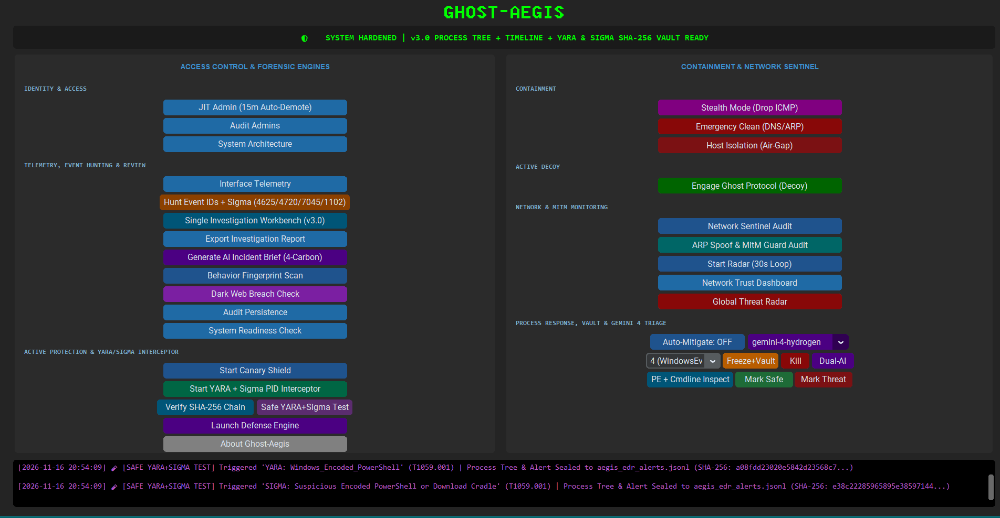

# 🛡️ Ghost-Aegis SE v3.0 — AI-Assisted Enterprise EDR/XDR & Forensic IR Platform


**Ghost-Aegis SE (Sentinel Edition)** is a host-based Endpoint Detection & Response (EDR), Extended Detection & Response (XDR), and Digital Forensics & Incident Response (DFIR) workbench built in Python and CustomTkinter. 

Designed with a **zero-DLL-dependency architecture** to operate cleanly on hardened Windows environments (WDAC/AppLocker), Ghost-Aegis combines real-time 50ms process interception, **native YARA and Sigma detection engines**, **Parent-Child Lineage Masquerading detection**, **PID-reuse-validated Process Ancestry Trees**, **XDR Threat Campaign Clustering**, **Ransomware Early Warning I/O correlation**, **Purple Team Adversary Emulation**, and **SHA-256 Cryptographic Chain-of-Custody sealing**.

---

## 📸 Live Platform Screenshots (v3.0)

### 1. Single Investigation View Workbench (Process Ancestry Tree & Kill-Chain Timeline)
*Correlates live `psutil` PPID process lineage (`explorer.exe` $\rightarrow$ `Code.exe` $\rightarrow$ `pwsh.exe` $\rightarrow$ `python.exe`), Windows Event ID `7045` Sigma detection (`T1543.003`), Threat DNA hashing (`50C4C343ECF9C0AA`), and verified SHA-256 chain-of-custody seals in a single pane:*


### 2. Main EDR/XDR Command Console & Cryptographic Alert Sealing
*Real-time YARA + Sigma PID interception, Windows Event ID hunting, Active Containment (Air-Gap, Quarantine Vault, ICMP Stealth), Purple Team Simulation, and tamper-evident SHA-256 ledger logging:*



---

## 🚀 What's New in v3.0 (Enterprise XDR Release)

* **🖥️ Single Investigation View Workbench:** Unified side-by-side SOC investigation console correlating Process Ancestry Trees, 5-stage Attack Kill-Chain Timelines, XDR Campaign Clusters, Threat DNA hashes, MITRE ATT&CK mappings, and cryptographic block seals in one pane.
* **🌳 Live Process Ancestry Tree (`AegisForensicCorrelator`):** Walks the `psutil` Parent PID (`PPID`) chain up to 6 levels deep upon detection. Implements creation-time validation (`parent.create_time() <= child.create_time()`) to prevent Windows PID-recycling false positives.
* **📜 Native Pure-Python Sigma Engine (`AegisSigmaEngine`):** Zero-dependency YAML parser evaluating both real-time process creation command lines and Windows Security/System Event IDs (`4625`, `4720`, `7045`, `1102`) without requiring external binary compilers.
* **🧬 Parent-Child Masquerading Detector (`ParentChildAnomalyDetector`):** Behavioral lineage engine that flags anomalous process spawns (`wmiprvse.exe`, Office macros, or `spoolsv.exe` spawning shells; `svchost.exe` spawned outside `services.exe`; or core system binaries executing outside `C:\Windows\System32`).
* **🔗 XDR Threat Campaign Clustering (`ThreatCampaignCorrelator`):** Automatically groups multi-stage YARA, Sigma, Lineage, and Ransomware alerts across shared Root PIDs and Threat DNA hashes into unified attack campaigns (e.g., correlating `T1047` + `T1059.001` + `T1218` under a single Root PID).
* **🛑 Ransomware Early Warning Engine (`RansomwareEarlyWarning`):** Correlates Canary file modifications with live `psutil` disk write-byte spikes (`io_counters()`) and PE Shannon entropy to attribute and auto-freeze encrypting processes in RAM.
* **⚔️ Built-In Purple Team Adversary Simulator:** Interactive 5-scenario MITRE ATT&CK emulator (`T1059.001`, `T1218`, `T1047`, `T1036.005`, `T1486`) that safely fires benign telemetry and spawns real child PIDs to validate detection, lineage reconstruction, and SHA-256 sealing live.
* **📡 Live SOAR Webhook Dispatcher (`SoarWebhookDispatcher`):** Streams real-time Markdown incident cards (including Process Lineage, MITRE ID, and SHA-256 Chain Seals) to Discord or Slack SOAR channels alongside UDP CEF SIEM streaming.

---

## 🏛️ Enterprise Capability Mapping

| Module / Engine | Security Domain | Technical Implementation | MITRE ATT&CK Coverage |
| :--- | :--- | :--- | :--- |
| **YARA + Sigma PID Interceptor** | EDR / Detection Engineering | 50ms kernel PID table diffing with pure-Python `.yar` and `.yml` regex/keyword evaluation | `T1059.001`, `T1218` |
| **Parent-Child Lineage Guard** | Behavioral EDR | Evaluates `PPID` ancestry for WMI/Office shell spawns & non-`System32` binary masquerading | `T1047`, `T1036.005`, `T1566.001` |
| **Process Tree & Timeline Engine** | DFIR / Threat Hunting | Multi-level `PPID` lineage walk with PID-recycling defense + 5-stage kill-chain reconstruction | Execution & Lineage |
| **XDR Campaign Correlator** | Extended Detection (XDR) | Clusters multi-engine alerts across shared Root PIDs, Threat DNA hashes, and MITRE tactics | Multi-Stage Correlation |
| **Ransomware Early Warning** | Active Ransomware Defense | Correlates Canary trips with process `write_bytes` spikes + PE Shannon entropy + auto-vaulting | `T1486` |
| **Cryptographic Chain Auditor** | Digital Forensics / Compliance | Tamper-evident SHA-256 hash chaining (`prev_hash` + sorted JSON payload seal) in `aegis_edr_alerts.jsonl` | `T1070` (Anti-Tamper) |
| **Forensic Quarantine Vault** | SOAR / Active Containment | Suspends threads in RAM (`proc.suspend()`) to defeat watchdogs, copies sample, writes SHA-256 manifest, kills PID | Automated Containment |
| **Purple Team Simulator** | Adversary Emulation | 5-scenario safe MITRE ATT&CK generator (including live benign child PID spawns) for instant verification | `T1059`, `T1218`, `T1047`, `T1486` |
| **Windows Event Hunter** | Host XDR Telemetry | Live `wevtutil` querying + Sigma correlation for brute-force (`4625`), rogue users (`4720`), services (`7045`), and log clears (`1102`) | `T1110`, `T1136`, `T1543.003`, `T1070.001` |
| **Multi-Model AI Reasoning** | AI Security Copilot | DLL-safe REST cascade (`gemini-4-hydrogen` → `argon` → `carbon`) + Copilot / local Ollama (`qwen2.5:7b`) | Tier-2/3 Triage |

---

## 🛠️ Installation & Quick Start

### Prerequisites
* **OS:** Windows 10 / 11 (Run as Administrator for Windows Firewall containment and Security Event Log hunting)
* **Python:** Python 3.11+

### 1. Clone & Install Dependencies
```bash
git clone [https://github.com/JosephAwana23/Ghost-Aegis.git](https://github.com/JosephAwana23/Ghost-Aegis.git)
cd Ghost-Aegis
pip install psutil customtkinter requests python-dotenv tkintermapview
